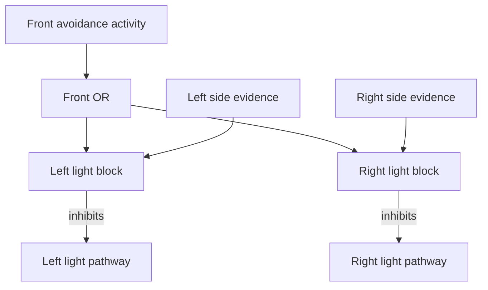

# Interacting Goals: avoidance, light approach and search with Prima-Lux

Build a brain whose goals meet in the same body. A simulated differential-drive
robot approaches a light, responds to front obstacles, uses side obstacles to
constrain its approach, and searches when those sensory pathways are quiet.
The neural dynamics run on Prima-Lux; Webots provides the body and environment.

**Lesson:** define a goal through its evidence, candidate actions and stopping
conditions. Then decide where another goal should support it, compete with it,
or suppress it. This example makes those relationships visible in the graph.

## What you will learn

- Build repeated sensory pathways with rhythms and TNorms.
- Compare left and right evidence using equal, opposing operand units.
- Give obstacle avoidance priority by inhibiting the light-approach pathway.
- Block one candidate action without disabling the entire goal.
- Make a search loop yield through inhibition of its reset population.
- Clear bistable outputs and keep the body synchronized with a neural ACK.

## What you need

**GET SYNTHETIC NEURONS:** [Prima-Lux Dev Kit with capacity for up to 10,000 synthetic neurons](https://artificialbrains.ai)


| Requirement | Details |
| --- | --- |
| Computer | Ubuntu 24.04 x86_64, graphical desktop and OpenGL |
| Git and Python | Git; Python 3.11+ with venv, Python 3.12 recommended |
| Webots | R2025a, installed separately on your computer |
| Prima-Lux | Onboarded, reachable device and its developer API key |
| SDK | `artificialbrains_sdk==0.4.0`, installed by this project |
| Internet | For initial dependencies and brain compilation |

No physical e-puck is required. The supplied `worlds/interacting_goals.wbt`
contains the robot, arena, obstacles and light. It has no external PROTO downloads.
The package installs its Python requirements and **does not install Webots**.
See [requirements](docs/REQUIREMENTS.md).

## Clone, install, design, build and run

### 1. Clone

```bash
git clone https://github.com/artificial-brains-inc/interacting-goals.git
cd interacting-goals
```

### 2. Install

```bash
bash install.sh
source .venv/bin/activate
```

The installer creates or repairs `.venv`, restores missing pip, and installs
all project Python dependencies. On Ubuntu it installs missing Python system
prerequisites using apt when needed; that may require sudo. Existing device
settings and saved design edits are preserved.

Open the generated `.env` in a text editor. Enter the address and developer API
key from your Prima-Lux interface. Point Webots to its actual executable file,
not its installation directory:

```dotenv
AB_DEVICE_URL=http://prima-lux.local:8080
AB_DEVICE_API_KEY=YOUR_PRIMA_LUX_DEVELOPER_API_KEY
AB_TELEMETRY=true
WEBOTS_EXECUTABLE=/absolute/path/to/webots
```

If Webots is on PATH or in a supported common location, its setting is optional.
Keep `.env` private; Git ignores it. Install Webots separately from the
[Cyberbotics R2025a release](https://github.com/cyberbotics/webots/releases/tag/R2025a).

### 3. Inspect the brain with the SDK

```bash
ab design --brain brain.abdesign.json --env .env
```

The brain is named **Interacting Goals**. For the first run, inspect the supplied
design unchanged. Trace `FRONT_RIGHT` to `A_TURN_LEFT`, then follow `FRONT_ANY`
into both light-blocking pathways. Find the connection from `ANY_GOAL` to
`SEARCH_RESET` and inspect its inhibitory strength of 2.5.

Close the Designer with Ctrl+C in its terminal when finished. If you edit the
graph, **Save brain** downloads the edited JSON. Save it as this project's
`brain.abdesign.json` before building. With the supplied brain name:

```bash
cp "$HOME/Downloads/interacting-goals.abdesign.json" brain.abdesign.json
```

Use the actual filename if you renamed the brain. Keep exactly one
`*.abdesign.json` file in the project root.

### 4. Build and install the brain on Prima-Lux

Stop any active session on the device before building:

```bash
ab device --env .env stop
ab build brain --brain brain.abdesign.json --env .env
```

Wait for the build to confirm the installed brain is READY. This step compiles
the saved public design. It does not start Webots.

### 5. Run

```bash
ab run -ab --env .env
```

The SDK runs `run.py`, which opens your existing Webots installation and connects
the robot to the installed brain. Installation, design and build remain separate
SDK stages; running does not repeat them.

For each observation the controller waits for a fresh neural ACK, applies the
wheel outputs from that same frame immediately, and advances Webots by 32 ms.
It captures the next observation after the ACK clears. The body does not advance
while waiting, and there is no additional readout window after ACK.
See [ACK synchronization](docs/ACK.md).

## Understand the environment

The world contains a camera, front and side proximity sensors, two light sensors,
and two driven wheels. Its light supervisor presents targets at different angles.
When the robot is aligned and approaching, the supervisor switches the light off
for four **simulation seconds**, then presents another target.

The supervisor reads the simulated pose to arrange and aim the stimulus. It
never commands the wheels or sends target coordinates to the brain. The brain
receives the camera and sensor measurements. This is an approach-and-reorient
exercise; the light changes after an approach condition, not after arrival at a
destination. Read [the environment and sensor contract](docs/DESIGN.md).

## How to build a goal

Describe the condition you want and the evidence that could support or oppose
an action. Then specify what makes that action end. In this design:

| Goal or supporting behavior | Evidence | Candidate action | How the action changes or ends |
| --- | --- | --- | --- |
| Move through the scene | Camera activity | Support both forward wheels | Turn pathways inhibit motor populations and clear wheel outputs |
| Avoid front obstacles | Independent front-left/right pathways | Suppress the wheel that produces a turn away | Changing proximity evidence and mutual turn inhibition alter support |
| Approach the light | Left/right light values and their signed comparisons | Suppress the wheel on the brighter side to turn toward it | Opposing light evidence and obstacle gates suppress the relevant pathway |
| Respect side obstacles | Side proximity pathways | Block approach toward the obstructed side | The corresponding side evidence must subside |
| Search for useful sensory evidence | Right motor activity, opposed by combined goal activity | Repeatedly reset the right motor pathway | `ANY_GOAL` inhibits `SEARCH_RESET` when sensory goal activity is present |

A goal is expressed through these neural relationships. Changing wheel speed
changes how an output moves the body; it does not change the goal. The camera
provides scene-dependent drive here, not object recognition or a guaranteed
forward command in darkness.

Each proximity/light path is **input → high-gamma relay → Theta T3 → Theta
T2.01 → Beta T5**. The light comparison then uses Beta T3 with one positive
operand from its own side and one negative operand from the opposite side.
Read the construction in [design_brain.py](design_brain.py).

## How the goals interact

Choose interactions at the pathways and actions that actually conflict. This
example uses a hierarchy of inhibition, not a Python priority selector.

| Situation | Neural relationship | Intended effect to check |
| --- | --- | --- |
| Right front obstacle | `FRONT_RIGHT_T2` excites `A_TURN_LEFT` | Suppress left wheel and turn left |
| Either front turn is active | `FRONT_ANY` feeds both `BLOCK_LIGHT_*` operators | Reduce both light-approach pathways while front avoidance acts |
| Left side obstacle and left light | `SIDE_TURN_RIGHT` feeds `BLOCK_LIGHT_LEFT` | Block the light turn toward the left obstacle |
| Right side obstacle and right light | Mirrored side gate | Block the light turn toward the right obstacle |
| Left and right light compete | Each comparison gets its own positive and opposite negative operand | Express directional evidence inside the brain |
| Front, side or light goal activity is present | Their OR hierarchy inhibits `SEARCH_RESET` | Let the sensor-driven behavior interrupt search |
| Goal activity subsides | Suppression of `SEARCH_RESET` decreases | Allow the search loop to resume |

The side populations have **no direct motor or wheel connections**. They
constrain light approach and participate in the search-suppression hierarchy.
The two front-turn populations inhibit one another, as do the two side-turn
populations. The two light comparisons instead receive matched opposing operands.



Each OR input contributes one complete operand unit. A veto connection has a
different role from arithmetic subtraction. Inhibition is relative to a
calculated reference: `strength=2.5` is a multiplier, not a promise of a specific
percentage of neural suppression. Rhythms, TNorms, operand units and inhibition
strength describe different design choices.

Output lifetime is another separate choice. A turn pathway inhibits both the
motor OPU and its bistable wheel output. Inhibiting only an upstream population
may leave a previously active output held. The search reset similarly inhibits
`CAMERA_T2_RIGHT` and clears `WHEEL_RIGHT`.

Use the worked conflict exercise in [GOALS.md](docs/GOALS.md) before adding a goal.

## Observe, change and rebuild

The console shows front/side proximity, light readings, wheel speeds, ACK and
decision steps, and the ratio of simulation time to wall time. ACK and decision
steps must match. `logs/` contains measured inputs, submitted activity, ACK timing
and actual applied output frames. With `AB_TELEMETRY=true`, use the SDK telemetry
view to inspect the named neural populations over time.

The supplied settings are:

```json
{
  "physics_step_ms": 32,
  "proximity_full_scale": 1000.0,
  "wheel_speed_rad_s": 3.0,
  "output_timeout_seconds": 5.0,
  "ack_timeout_seconds": 30.0
}
```

For more movement per ACK, use `physics_step_ms: 64` or `128` and restart. This
advances more simulation time between observations while retaining the ACK wait.
Use positive integer multiples of the world's 16 ms physics interval. Wheel
speed is limited to the included motors' 8 rad/s maximum.

Edit and save the graph in `ab design`, then build and run again:

```bash
ab build brain --brain brain.abdesign.json --env .env
ab run -ab --env .env
```

To learn the public Python API, edit `design_brain.py` and explicitly regenerate:

```bash
python design_brain.py
ab design --brain brain.abdesign.json --env .env
```

Regeneration overwrites the saved JSON. Installation and runtime do not regenerate
it, so Designer edits remain the design that gets built.

## Stop and preserve neural state

Close Webots or press Ctrl+C in the terminal running `ab run`. The launcher
requests SDK Stop/save and waits for an idle STOPPED state, even if Webots kills
its controller first. Keep the terminal open until **Prima-Lux Stop/save
confirmed** appears. Automatic cleanup needs a reachable device and a running
launcher; failures are reported in `logs/launcher_state.json`.

From a second activated terminal you can also use:

```bash
ab device --env .env stop
ab device --env .env status
```

Stopping saves neural dynamics. The application does not reset them automatically.
For an intentional fresh-state experiment, stop first, then use
`ab device --env .env reset-dynamics` and wait until status reports an idle READY
or STOPPED state before running again. Resetting Webots is a separate operation.

## Test the relationships

1. Observe a light-led turn in free space and identify the suppressed wheel.
2. Put a front obstacle in the approach direction. Follow `A_TURN_*`,
   `FRONT_ANY`, and both light gates; check physical avoidance and recovery.
3. Put a side obstacle beside a same-side light. Check that only that approach
   channel is blocked, with no direct side-to-wheel actuation.
4. Observe a light blackout. Check how search activity changes when other
   sensory goal activity is quiet, and how the returning light interrupts it.
5. In a copy of the design, remove one goal-interaction edge. Predict the
   conflict it will expose, rebuild, and compare the observed behavior.

```bash
python -m unittest discover -s tests -v
```

Local checks cover topology, public SDK commands, encoding, synchronous ACK and
shutdown behavior. They do not establish live neural dynamics or collision-free
behavior. Follow [VALIDATION.md](docs/VALIDATION.md) on Webots and Prima-Lux.

| File | Purpose |
| --- | --- |
| `design_brain.py` | Readable construction with the public SDK |
| `brain.abdesign.json` | Saved design for Canvas and compilation |
| `config.json` | Body timing, encoding scale, wheel speed and timeouts |
| `goals/sensors.py` / `goals/motors.py` | Measurements and body/output mapping |
| `goals/ack.py` / `goals/bridge.py` | Synchronous observation/ACK/action loop |
| `goals/application.py` | Webots launch and independent Stop/save confirmation |
| `controllers/light_stimulus/` | Environmental light presentation |
| `worlds/interacting_goals.wbt` | Self-contained experiment world |
| `docs/GOALS.md` | Goal design, conflict worksheet and exercises |
| `docs/DESIGN.md` | Operating points, input contract and world behavior |

Continue with the [Guide to Building an Artificial Brain](https://github.com/artificial-brains-inc/Guide-to-Building-an-Artificial-Brain)
and the [Artificial Brains SDK](https://github.com/artificial-brains-inc/artificial_brains).

## License

You may clone, use, modify and redistribute this example for projects using
Artificial Brains products, including commercial projects, under the
[Artificial Brains Example Code License](LICENSE). SDKs, hardware and firmware
retain their own licenses.
